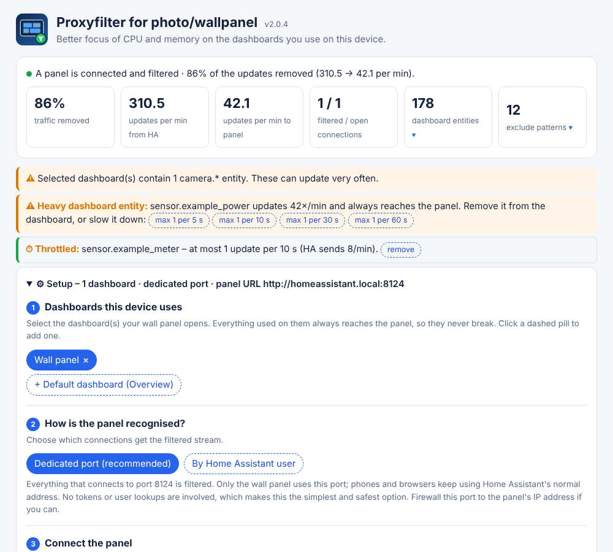
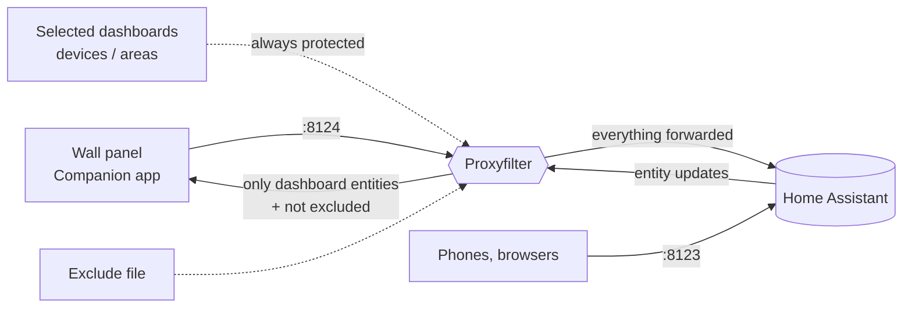

<p align="center">
  
</p>

<h1 align="center">Proxyfilter for photo/wallpanel</h1>

<p align="center">
  Keeps your <b>wall panel, tablet or photo frame blazing fast</b> by only forwarding the entity updates<br>
  that the dashboard on that device actually uses. A Home Assistant add-on.
</p>

<p align="center">
  <a href="https://github.com/GruttePier013/nspanel-proxyfilter-wallpanel/releases"></a>
  
  
  <a href="LICENSE"></a>
</p>

<p align="center">
  🇳🇱 <a href="docs/HANDLEIDING.md"><b>Nederlandstalige handleiding</b></a> ·
  📖 <a href="proxyfilter_wallpanel/DOCS.md">Documentation</a> ·
  🔒 <a href="SECURITY.md">Security</a> ·
  📋 <a href="proxyfilter_wallpanel/CHANGELOG.md">Changelog</a>
</p>

<p align="center">
  <a href="https://my.home-assistant.io/redirect/supervisor_add_addon_repository/?repository_url=https%3A%2F%2Fgithub.com%2FGruttePier013%2Fnspanel-proxyfilter-wallpanel"></a>
</p>



---

## Contents

- [Why this add-on](#why-this-add-on)
- [Features](#features)
- [How it works](#how-it-works)
- [Requirements](#requirements)
- [Step 1: Install](#step-1-install)
- [Step 2: Select dashboards and how the panel is recognised](#step-2-select-dashboards-and-how-the-panel-is-recognised)
- [Step 3: Point the panel to port 8124](#step-3-point-the-panel-to-port-8124)
- [Step 4: Check and trim](#step-4-check-and-trim)
- [Exclude list and protection](#exclude-list-and-protection)
- [Throttling](#throttling)
- [Configuration options](#configuration-options)
- [Privacy and security](#privacy-and-security)
- [Troubleshooting](#troubleshooting)
- [FAQ](#faq)
- [Development](#development)
- [License](#license)

---

## Why this add-on

A Home Assistant dashboard subscribes to **every** entity in your system, not only the ones on screen.
On a big installation that is thousands of updates per minute (power meters, inverters, network
sensors). A phone shrugs that off; a cheap wall panel or photo frame spends its little CPU and memory
on it, and becomes slow or stutters.

This add-on sits between the panel and Home Assistant. It forwards everything, but changes the
entity subscription of the panel so that it **only receives the entities its dashboard needs**.

## Features

- 🛡️ **Dashboard entities always reach the panel**, so the exclude list cannot break it (also wildcards, devices and areas used on the dashboard).
- 🖥️ **Visual web UI in the sidebar:** dashboards, exclude-list editor, *Check an entity*, throttling, self-test.
- 🐢 **Throttling** for busy dashboard entities (max one update per 2 s up to 5 min, always the latest state).
- 🔓 **Fail-open:** when in doubt the panel gets the normal, unfiltered stream.
- 🔒 **Hardened:** read-only access to the Home Assistant config, local network only, see [SECURITY.md](SECURITY.md).
- 🧩 **Made for small CPUs:** Rockchip, Allwinner, Amlogic, MediaTek, Raspberry Pi Zero 2 W / 3.
- 🌍 Configuration options in English and Dutch.
- ✅ Automated end-to-end and security tests against a mock Home Assistant.

## How it works



Only the websocket entity subscription (`subscribe_entities`) of the filtered connections is
changed. An entity reaches the panel when it is used on a selected dashboard (**always**), or, in
*exclude* mode (default), when it does not match the exclude file. New entities pass automatically
in exclude mode, so nothing you add to Home Assistant later disappears from the panel.

## Requirements

- **Home Assistant OS or Supervised** (add-ons need the Supervisor); architectures **aarch64** and **amd64**.
- A wall panel, tablet or photo frame running the **Home Assistant Companion app** (or a kiosk browser).

## Step 1: Install

1. Click the *Add repository* button above, or add `https://github.com/GruttePier013/nspanel-proxyfilter-wallpanel`
   under **Settings → Add-ons → Add-on store → ⋮ → Repositories**.
2. Install **Proxyfilter for photo/wallpanel** and start it.
3. Open **Proxyfilter** in the sidebar. The *Setup* block opens by itself until a dashboard is
   selected and a panel has connected.

> Install from the repository, not as a copy in `/addons`: Home Assistant never updates local add-ons.

## Step 2: Select dashboards and how the panel is recognised

1. **Select your dashboard(s):** click the dashed pill of the dashboard your panel opens; add more if
   the panel switches between dashboards.
2. **Choose how the panel is recognised:**
   - **Dedicated port (recommended):** everything that connects to port **8124** is filtered. Only the
     wall panel uses 8124; phones and browsers keep using the normal address. No tokens or user lookups.
   - **By Home Assistant user:** one port serves everybody and only the selected user(s) are filtered.
     Create a dedicated user for the panel first (*Settings → People → Users*).

## Step 3: Point the panel to port 8124

In the **Companion app** on the panel:

1. **Settings → Companion app → Servers** (or *Server & network*) → tap your server.
2. Set the **internal connection URL** to `http://<home-assistant-ip>:8124`. If there is an
   *external URL*, set it to the same address, so the app does not fall back to port 8123.
3. Go back to the dashboard; close and reopen the app if it keeps the old connection.

Can't find the setting? Remove the server and add it again with `http://<home-assistant-ip>:8124`.
For a kiosk browser or photo-frame app, set its start URL to `http://<home-assistant-ip>:8124`
(add your dashboard path, e.g. `/dashboard-wallpanel/0`).

> **Never forward port 8124 to the internet.** The add-on refuses public addresses by default.

## Step 4: Check and trim

1. Within a minute the summary shows `1 / 1` filtered connections and the log shows `ws auth … OK`.
   The log must not show a `NOT reachable` warning.
2. Orange *not set up for reverse proxies* warning? Add the `http:` block from
   [Advanced](proxyfilter_wallpanel/DOCS.md#advanced-client-addresses-bans-and-trusted_proxies) and restart Home Assistant.
3. After a few minutes the UI lists the **noisiest entities** that still reach the panel: click
   **exclude** (or a wildcard pill) and **Save**. The filter reloads within 30 seconds; *Traffic removed* rises.

## Exclude list and protection

- The exclude file lives in the add-on's **own** config folder (`addon_configs/…_proxyfilter_wallpanel`)
  and is created automatically with commented examples. A `.bak` copy is kept on every save.
- One pattern per line, `*` and `?` are wildcards, `#` starts a comment: `sensor.example_inverter_*`.
  Pasting a line from the add-on log works too.
- **Always protected**, even when a pattern matches: entity IDs written in the dashboard, wildcards in
  the dashboard (e.g. `auto-entities`), and all entities of a **device** or **area** the dashboard refers to.
- **Check an entity** in the UI tells you exactly why an entity is passed or blocked.

## Throttling

Dashboard entities always reach the panel, even when they update every second. The **Throttling**
card lists the busiest entities with a drop-down per entity (max one update per 2 s up to 5 min).
Updates in between are merged and the latest state is delivered, so the panel never shows a stale value.

## Configuration options

Everything has a sensible default. Dashboards, filter scope and users are managed in the web UI.

| Option | Default | Description |
|---|---|---|
| `upstream` | `http://homeassistant:8123` | Home Assistant address as seen from the add-on |
| `mode` | `exclude` | `exclude`, or `include` (only dashboard entities pass, strict) |
| `exclude_file` | `proxyfilter_exclude.txt` | Path inside the add-on's own config folder (`.txt` or `.list`) |
| `max_connections` | `20` | Maximum simultaneous websocket connections; extra ones get HTTP 503 |
| `local_only` | `true` | Refuse connections from public IP addresses |
| `trusted_proxies` | empty | A reverse proxy placed *in front of* this add-on |
| `heavy_per_minute` | `20` | Updates per minute above which a dashboard entity triggers a warning |
| `top` | `25` | Lines per list in the log reports (0 = none) |
| `min_per_minute` / `min_per_hour` | `2` / `120` | Entities below these rates are hidden in log reports |
| `verbose` | `false` | Log every HTTP request |

The filtered port is **8124**; change it under *Network* in the Configuration tab (the Companion app
must then use the same port). All warnings and the self-test: [Documentation](proxyfilter_wallpanel/DOCS.md#reference).

## Privacy and security

The add-on is a reverse proxy: it sees all traffic of the panel, including login requests and access
tokens, and forwards it. Authentication stays with Home Assistant.

- **Filtering is a performance feature, not a security boundary:** it can only hide updates, never reveal more than Home Assistant would send.
- The Home Assistant config folder is mapped **read-only**; the add-on writes only its own config folder and private `/data`.
- Access tokens are never stored or logged.
- The web UI is reachable only through Home Assistant ingress (admins only).
- `local_only` refuses public addresses; client `X-Forwarded-For` headers are always replaced.

Full threat model: [SECURITY.md](SECURITY.md).

## Troubleshooting

| Symptom | Cause / fix |
|---|---|
| "Filtered / open connections" stays 0 | The panel does not use `:8124` yet. Check the server URL in the Companion app. |
| Nothing filtered in by-user mode | The panel's user is not selected, or the log says `ws user … passthrough`. |
| A card on the panel stays empty | The entity is excluded *and* not found on a selected dashboard (e.g. a YAML-mode dashboard or a custom card template). **Check an entity** shows why. |
| Panel login loops | Look for `login … -> 4xx` in the add-on log; check `upstream`. |
| Add-on build fails with a network error | The device cannot reach the container registry. Check DNS/internet (`ha dns restart`), then Rebuild. |

More: [Documentation → Troubleshooting](proxyfilter_wallpanel/DOCS.md#troubleshooting). Report problems in the
[issues](https://github.com/GruttePier013/nspanel-proxyfilter-wallpanel/issues).

## FAQ

**Will phones and browsers be filtered too?**
Not in *dedicated port* mode: only connections on port 8124 are filtered.

**Can the exclude list hide something my dashboard needs?**
No. Entities used on the selected dashboards (including their devices and areas) always pass.

**What about YAML-mode dashboards?**
They are not listed in the UI (their entities can't be read from storage). Convert them to storage
mode, or don't exclude their entities.

**Why can't `camera.*` or `media_player.*` be filtered?**
They update often and are needed whole; keep them off the wall-panel dashboard.

## Development

```bash
pip install aiohttp
python3 tests/test_all.py        # end-to-end and security tests against a mock Home Assistant
python3 assets/make_logos.py     # re-render icon.png and logo.png (needs playwright)
```

Publishing a GitHub release runs `.github/workflows/release-zip.yaml`: it tests the tagged code and
attaches a ZIP of the repository plus a SHA-256 file to the release.

Every release raises `version` in `proxyfilter_wallpanel/config.yaml`, in the script and in the top
entry of the changelog; the tests and CI check that they match. Without a new version number Home
Assistant offers no update.

Repository layout:

```
proxyfilter_wallpanel/   the add-on (config, Dockerfile, app, web UI, translations, DOCS.md)
tests/                   end-to-end and security tests
assets/                  logo sources and screenshot
docs/HANDLEIDING.md      Dutch guide
```

## License

**MIT** (see [LICENSE](LICENSE)).
