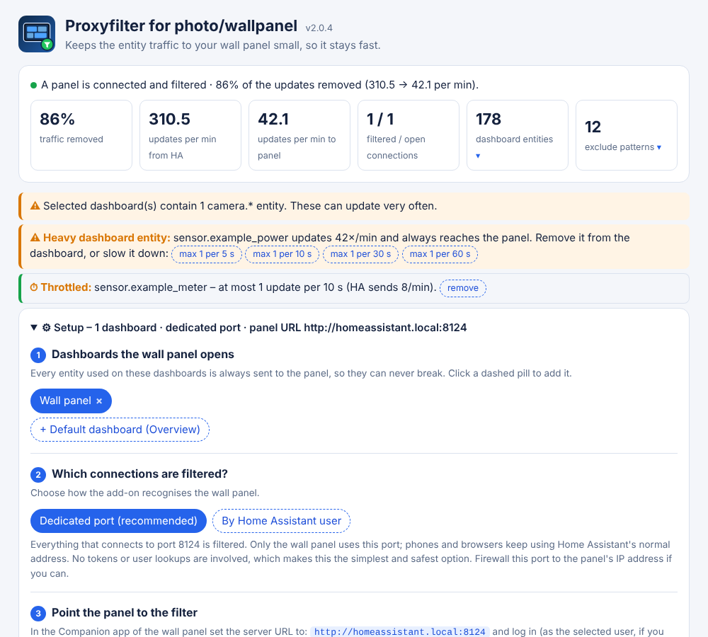

<p align="center"></p>

# Proxyfilter for photo/wallpanel

[](https://my.home-assistant.io/redirect/supervisor_add_addon_repository/?repository_url=https%3A%2F%2Fgithub.com%2FGruttePier013%2Fproxyfilter-wallpanel-addon)

**The filtering proxy keeps your wall-panel (like Sonoff, Tuya, Shelly) blazing fast by only forwarding traffic related to entities used in the dashboard you configured.**



- Dashboard entities always reach the panel, so the exclude list cannot break it
- Visual web UI in the sidebar: dashboards, exclude-list editor, throttling, self-test
- Fail-open: when in doubt the panel gets the normal, unfiltered stream
- Hardened: read-only access to the Home Assistant config, local network only, see [SECURITY.md](SECURITY.md)
- Made for small CPUs (Rockchip, Allwinner, Amlogic, MediaTek, Raspberry Pi Zero 2 W / 3)

## Requirements

- Home Assistant OS or Supervised (add-ons need the Supervisor); architectures aarch64, amd64, armv7
- A wall panel, tablet or photo frame running the Home Assistant Companion app
- Status: **experimental**. Tested against a mock Home Assistant; please report problems in the issues

## Install

1. Click the button above, or add `https://github.com/GruttePier013/proxyfilter-wallpanel-addon` under
   **Settings → Add-ons → Add-on store → ⋮ → Repositories**.
2. Install **Proxyfilter for photo/wallpanel** and start it.
3. Open it in the sidebar and follow the *Setup* block.

## More

[Documentation](proxyfilter_wallpanel/DOCS.md) · [Changelog](proxyfilter_wallpanel/CHANGELOG.md) · [Security](SECURITY.md) · [Issues](https://github.com/GruttePier013/proxyfilter-wallpanel-addon/issues) · [License](LICENSE)

## Development

```bash
pip install aiohttp
python3 tests/test_all.py        # end-to-end and security tests against a mock Home Assistant
python3 assets/make_logos.py     # re-render icon.png and logo.png (needs playwright)
```

Every release raises `version` in `proxyfilter_wallpanel/config.yaml`, in the script and in the top entry of the
changelog; the tests and CI check that they match. Without a new version number Home Assistant offers no update.
