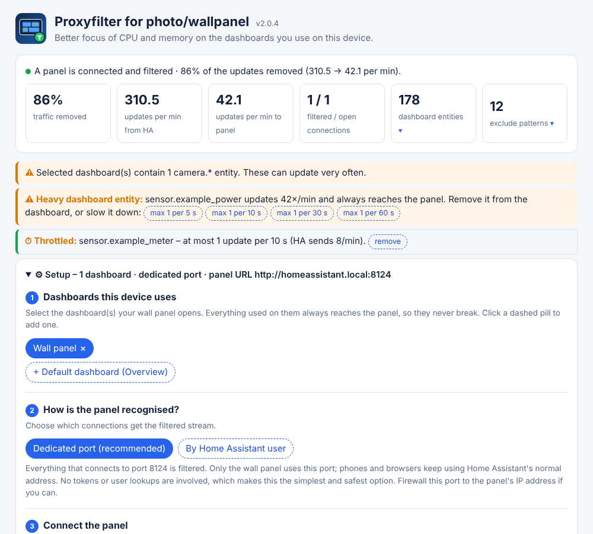

# Proxyfilter for photo/wallpanel

Home Assistant sends every state change of every entity to every open dashboard. A small wall panel, tablet or photo
frame spends most of its CPU and memory on updates it never shows. This add-on sits in between and forwards only what
the panel needs.

## What you gain

- **A faster, smoother panel.** Far fewer updates reach the device; the web UI shows your real *traffic removed*
  percentage.
- **Less CPU and memory used on the device**, which matters most on small hardware.
- **Nothing breaks.** Entities on the dashboards you select always pass, new entities keep working, and when in doubt
  the panel simply gets the normal stream.
- **No YAML and no disabled entities.** Everything is set up in a visual web UI.

## What you can configure

| In the web UI | What it does |
|---|---|
| **Dashboards** | Pick the dashboard(s) the panel opens; their entities are always sent |
| **Filter scope** | Filter a dedicated port (recommended) or only selected Home Assistant users |
| **Exclude list** | Block noisy entities you do not need; one-click suggestions and a "Check an entity" tool |
| **Throttling** | Slow down busy entities such as power meters instead of removing them |
| **Self-test and warnings** | Orange hints for heavy entities and risky setups |

The **Configuration** tab holds a few advanced options: mode (`exclude` or `include`), connection limit, local-only
access and log thresholds.

## How to use

1. **Start the add-on** and open **Proxyfilter for photo/wallpanel** in the sidebar (the web UI finishes the setup).
2. **Select your dashboard(s)** and choose how the panel is recognised.
3. **Point the panel to port 8124** (see below).
4. **Trim the list:** after a few minutes the UI shows the noisiest entities; click *exclude* and *Save*.

The **Documentation** tab explains each part of the web UI, the warnings and troubleshooting.

### Point the wall panel to port 8124

The filter listens on port **8124** of your Home Assistant. The panel must talk to that address instead of the normal
`:8123` one: `http://<home-assistant-ip>:8124` (plain `http`, use the IP address or hostname of your Home Assistant).

In the **Home Assistant Companion app** on the panel:

1. Open the app and go to **Settings → Companion app**.
2. Open **Servers** (or *Server & network*) and tap your server.
3. Set the **internal connection URL** to `http://<home-assistant-ip>:8124`. If the app also has an *external URL*,
   set it to the same address so the app does not fall back to port 8123.
4. Go back to the dashboard. If the panel still shows the old connection, close and reopen the app.

If you cannot find the setting, or the panel keeps its old connection, the cleanest way is to **remove the server and
add it again**: on the *Connect to Home Assistant* screen enter `http://<home-assistant-ip>:8124` and log in (as the user
you selected in the web UI, if you chose *By Home Assistant user*).

Menu names differ a little between app versions. For a kiosk browser or photo-frame app, set its start URL to
`http://<home-assistant-ip>:8124` instead (add your dashboard path, e.g. `/dashboard-wallpanel/0`, to open it directly).
You know it works when the web UI shows `1 / 1` filtered connections within a minute.

## Works well on small hardware

- **Rockchip** RK3326, RK3566 (budget Android tablets and panels)
- **Allwinner** A133, A64 (cheap Android tablets, wall displays)
- **Amlogic** S905 family (TV-box based displays)
- **MediaTek** MT8163, MT8167 (low-end tablets, e-readers)
- **Raspberry Pi** Zero 2 W and Pi 3 running a kiosk browser
- Android-based smart wall panels such as the Sonoff NSPanel Pro

> Never forward port 8124 to the internet. The add-on refuses public addresses by default.
